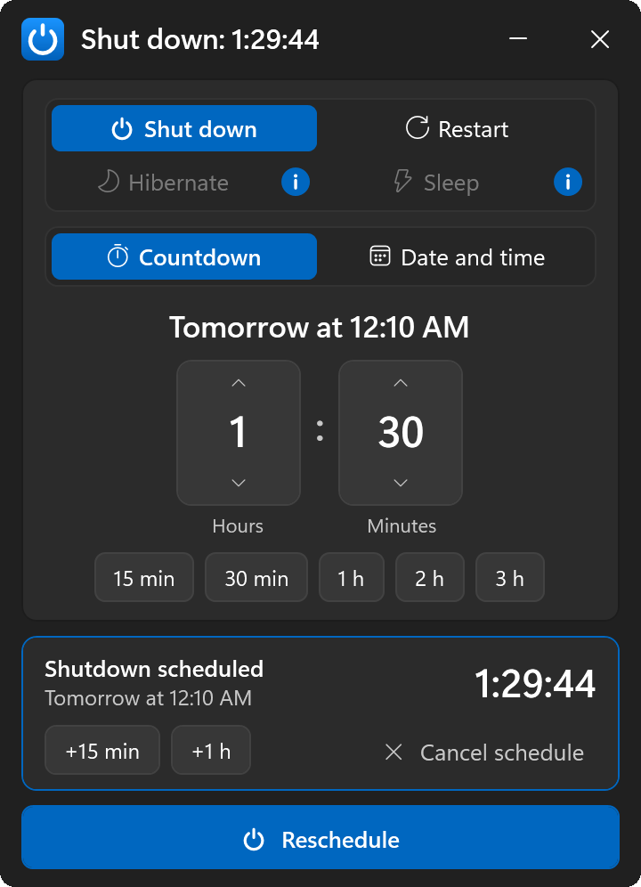

<h1 align="center">Shutdown</h1>

<p align="center">
  A small Windows tool that schedules shutdown, restart, hibernation or sleep.<br>
  No more seconds math for <code>shutdown /s /t 5400</code>.
</p>

<p align="center">
  <a href="../../releases/latest"></a>
  
  
  <a href="LICENSE"></a>
</p>

<p align="center">
  
</p>

## Features

- **Shut down, restart, hibernate or sleep** after a countdown with presets from 15 minutes to 3 hours, or at a chosen date and time.
- **See when it will happen** above the time fields. Once scheduled, the card and window title show the time left, and the taskbar shows progress.
- **Extend or cancel** a pending schedule from its card. Add 15 minutes or an hour with one click.
- Minimizing moves the window to the **notification area**. Click the tray icon to reopen the window or right-click for a menu with Open, Exit and, while a schedule is pending, +15 min and Cancel schedule.
- The **taskbar jump list** offers **Shut down in 30 minutes**, **Shut down in 1 hour** and **Cancel schedule** when you right-click the taskbar icon.
- **Fits into Windows:** English or German from the Windows display language, light or dark mode and the accent colour from your Windows settings.
- Runs as **a single executable** with no network access or telemetry.

## Install

Choose an installer or a portable copy from the [latest release](../../releases/latest).

- Run `Shutdown-Setup-<version>.exe` to **install for your Windows account or all users**. Setup creates a Start menu shortcut and offers a desktop shortcut. Pass `/LANG=en` or `/LANG=de` to override the setup language.
- Put the **portable executable** `Shutdown-<version>-windows.exe` in any folder and run it directly. You can also choose **Portable installation** in Setup to copy `Shutdown.exe` to a folder of your choice.

Requires Windows 10 (version 1903 or newer) or Windows 11. The .NET Framework 4.8 it needs is already part of Windows.

The exe is not code signed, so Windows SmartScreen may warn before the first start. Click **More info**, then **Run anyway**. To check the download, compare its SHA-256 hash with the matching line in `SHA256SUMS.txt` from the release:

```bat
certutil -hashfile Shutdown-<version>-windows.exe SHA256
```

## How it works

| Setting | What runs | Can the app be closed? |
|---|---|---|
| Shut down or restart | Windows itself: `shutdown /s /f /t <seconds>` (`/r` for restart) | Yes |
| Hibernate | The app counts down, then runs `shutdown /h /f` | No, keep it open |
| Sleep | The app counts down, then puts Windows to sleep | No, keep it open |

Shutting down or restarting always closes open apps, even with unsaved work. For hibernation and sleep, Shutdown keeps the PC awake during the countdown and asks before closing the app. If you put the PC to sleep by hand and it wakes more than two minutes after the target time, the app skips the action and tells you it was missed.

Starting the app a second time brings the open window to the front.

## Command line

Use `Shutdown.exe` or the filename of your portable copy. An action switch on its own selects that action in the window. A time switch schedules the selected action immediately, using the saved selection if you omit the action switch. If Shutdown is already open, it brings the window forward and applies the command there.

| Switch | Effect |
|---|---|
| `--shutdown`, `--restart`, `--hibernate`, `--sleep` | Select one action. |
| `--in <minutes>` or `--in <h:mm>` | Schedule a countdown, for example `--in 90` or `--in 1:30`. |
| `--at <hh:mm>` | Schedule at a local time on the 24-hour clock, for example `--at 22:30`. Uses today if that time is ahead, or tomorrow if it has passed. |
| `--abort` | Cancel the schedule set by Shutdown. Use this switch alone. |

Switch names are case-insensitive and also accept a `/` prefix, as in `/sleep /in 30`. Scheduling requires at least one minute of lead time.

When Shutdown is already open, the second start ends with exit code 0 once the open window has taken the command, 2 when another command is still being handed over, and 3 when the open window did not answer. Invalid switches are reported in the window.

## Files

Settings (`Shutdown.settings.json`) and a small log (rotated at 512 KB, one old copy kept) live in `%APPDATA%\Shutdown`. For an installed copy, use Windows Settings to uninstall Shutdown and optionally delete that data. Uninstalling also cancels a shutdown or restart that Shutdown scheduled. For a portable copy, delete the exe and optionally delete the data folder.

## Build from source

Requires the .NET SDK 8 or newer (it builds for .NET Framework 4.8 through reference assemblies).

```bat
build.bat
```

This builds `dist\Shutdown.exe` without starting it. Set `NOPAUSE=1` to never wait for a key on errors. A second run with nothing changed reports "up to date" and builds nothing; `build.bat --force` or `FORCE=1` rebuilds.

`release.bat` uses Inno Setup 6 to build `Shutdown-Setup-<version>.exe`. It writes the installer, portable exe and `SHA256SUMS.txt` to `dist\release`.

Run the tests:

```bat
dotnet test tests\Shutdown.Tests
```

## Security

Please report security problems privately, as described in [SECURITY.md](SECURITY.md).

## License

[MIT](LICENSE)

<p align="right">© 2026 BGCoding · Made with Claude</p>
