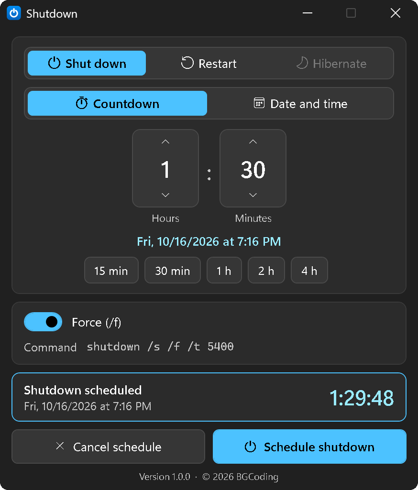

<h1 align="center">Shutdown</h1>

<p align="center">
  A tiny portable Windows tool that schedules a shutdown, restart or hibernate.<br>
  No more seconds math for <code>shutdown /s /t 5400</code>.
</p>

<p align="center">
  <a href="../../releases/latest"></a>
  
  
  <a href="LICENSE"></a>
</p>

<p align="center">
  
</p>

## Features

- **Shut down, restart or hibernate** after a countdown (hours and minutes, quick picks from 15 minutes to 4 hours) or at an exact date and time.
- **Always know what happens:** the target time, a live countdown and the exact `shutdown.exe` command are shown.
- **Cancel with one click** whatever the app scheduled.
- **Fits into Windows:** English or German from the Windows display language, light or dark mode and the accent colour from your Windows settings.
- **Portable and private:** one small `.exe` (about 110 KB), no installer, no network access, no telemetry.

## Download

1. Get `Shutdown-<version>-windows.exe` from the [latest release](../../releases/latest).
2. Put it in any folder (rename it if you like) and run it.

Requires Windows 10 (version 1903 or newer) or Windows 11. The .NET Framework 4.8 it needs is already part of Windows.

The exe is not code signed, so Windows SmartScreen may warn before the first start. Click **More info**, then **Run anyway**. You can compare the file with `SHA256SUMS.txt` from the release:

```bat
certutil -hashfile Shutdown-<version>-windows.exe SHA256
```

## How it works

| Setting | What runs | Can the app be closed? |
|---|---|---|
| Shut down or restart, **Force** on | Windows itself: `shutdown /s /f /t <seconds>` (`/r` for restart) | Yes |
| **Force** off, or **Hibernate** | The app counts down, then runs the command with `/t 0` | No, keep it open |

Windows always forces apps closed when a timeout is set, and it has no timer for hibernate. That is why those cases are timed by the app. Closing the window then asks first, and the PC is kept from going to sleep on its own until the time is up. If you put the PC to sleep by hand and it wakes more than two minutes after the target time, nothing runs and the app tells you so.

Starting the app a second time brings the open window to the front.

## Files

Settings (`Shutdown.settings.json`) and a small log (rotated at 512 KB, one old copy kept) live in `%APPDATA%\Shutdown`. Nothing is written next to the exe. To remove the app, delete the exe and that folder.

## Build from source

Requires the .NET SDK 8 or newer (it builds for .NET Framework 4.8 through reference assemblies).

```bat
build.bat
```

This builds `dist\Shutdown.exe` and starts it. Set `NOSTART=1` to skip the start and `NOPAUSE=1` to never wait for a key on errors.

`release.bat` builds the release files (`dist\release\Shutdown-<version>-windows.exe` and `SHA256SUMS.txt`).

Run the tests:

```bat
dotnet test tests\Shutdown.Tests
```

## Security

Please report security problems privately, as described in [SECURITY.md](SECURITY.md).

## License

[MIT](LICENSE) © 2026 BGCoding

Made with Claude.
